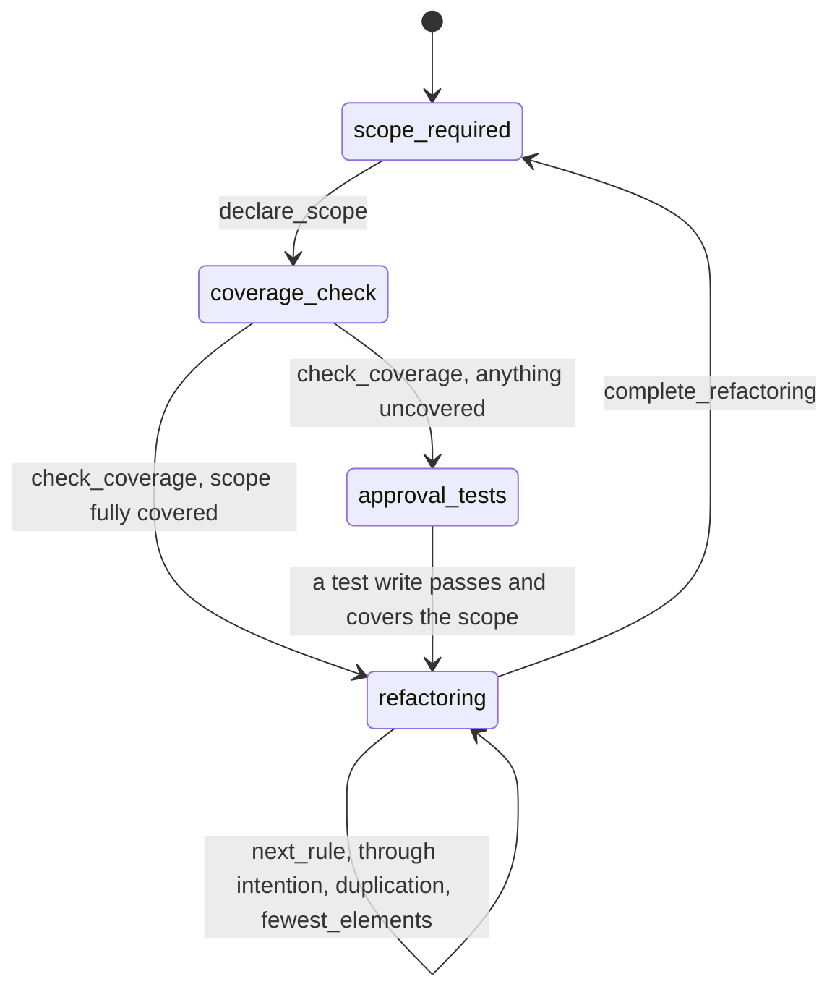

# Refactoring MCP

An [MCP](https://modelcontextprotocol.io/) server that makes coding agents refactor safely. Code
files are written through this server, which only allows each kind of change when the workflow
permits it:



| Phase | Test files | Production files | Approved baselines | Leaves when |
|---|---|---|---|---|
| `scope_required` | locked | locked | locked | `declare_scope` names the files to refactor |
| `coverage_check` | locked | locked | locked | `check_coverage` measures the scope |
| `approval_tests` | writable | **locked** | writable | a test write passes and covers every line and branch in the scope |
| `refactoring` | writable | writable | **locked** | `complete_refactoring`, after the last rule of simple design |

Every reply starts with `Phase: <phase>` (and `Rule: <rule>` while refactoring) and ends with what
to do next, and every refusal says how to get unstuck, so agents (including small local models)
always know where they are.

### Production code is locked until its behaviour is pinned

Refactoring means changing structure without changing behaviour. You cannot know you preserved
behaviour that nothing measures, so production code stays locked until every line **and branch**
in the declared scope is covered. That single rule is the point of this server.

"Covered" means **measured and gapless**. A file no test imports has no uncovered lines, so it
looks exactly like a fully covered file in a coverage report — it is simply absent from it. The
server therefore requires every scope file to appear in the report *and* have no missing lines or
branches. A scope no test touches routes to `approval_tests`, never to `refactoring`, and the reply
names the files nothing exercises.

### One approval test, pinning what the code does today

In `approval_tests`, write one test that calls the scope the way a caller does, captures what it
returns or prints, and approves that as the baseline. Assert the **current** behaviour, not the
behaviour you wish for: a bug stays a bug through a refactoring. Refactoring unlocks when the suite
passes and the scope is fully covered.

Approved baselines (`*.approved.*`) are writable while pinning and locked while refactoring.
Rewriting one is the only way to make a changed behaviour look green, so the server refuses it and
says where a real behaviour change belongs: a test-driven cycle.

### The four rules of simple design, one at a time

The rules are a **priority order**, not a pipeline: among designs that pass the tests, prefer the
one that reveals intention; among those, the one without duplication; among those, the one with
fewest elements. You consult them at every decision rather than finishing one and moving on.

**Rules 2 and 3 form a loop.** Naming a concept exposes the duplication it was hiding, and removing
duplication creates an abstraction that needs a name. They feed each other, so they iterate until
both are clean *at the same moment* — and only then does rule 4 apply, because deleting elements
while duplication remains hides it instead of removing it.

Measured on the Gilded Rose kata, naming cleared intention 5→1→0, at which point duplication
appeared 0→1; removing it reached the fixpoint, and rule 4 ran last:

```
commit    intention  duplication   loop      rule 4
8fd6ee7       1           0        running   locked
5b89c59       0           1        running   locked   <- naming exposed duplication
61d327a       0           0        SETTLED   open     <- fixpoint
6e4be13       0           0        SETTLED   open     <- rule 4 work
```

`rule_status` shows all three rules with their state and detected targets, and names the highest
outstanding one. `next_rule` refuses to enter rule 4 until the loop settles. When an edit buys a
lower-ranked rule by spending a higher-ranked one — extracting a cryptically named helper to kill
duplication — the reply says which rule outranks which:

| Rule | Hunt for |
|---|---|
| 2. `intention` | unclear names, long methods, primitive obsession, magic values, comments |
| 3. `duplication` | duplicate code, shotgun surgery, data clumps, feature envy |
| 4. `fewest_elements` | dead code, speculative generality, large classes, needless indirection |

Rule 1, *passes all the tests*, is always on: any edit that breaks the suite is reverted
automatically, as is any edit that adds a test, because new behaviour is not refactoring. A lower
rule never justifies breaking a higher one — extracting a well-named method adds an element, and
rule 2 still wins.

**A rule that changed nothing was not applied.** `next_rule` and `complete_refactoring` refuse
while the current rule has touched no production code in the scope, because a counter you can
advance for free is not a workflow. When the code genuinely satisfies a rule already, call
`skip_rule(location, reason)`: the reason is recorded and echoed in every later reply and in the
completion summary, so an honest skip stays possible but becomes visible rather than silent.

To make the rules actionable rather than aspirational, each rule's guidance names **concrete
targets found in your scope** — not just smell categories. For Python this is a cheap `ast` pass
per rule:

| Rule | Detects |
|---|---|
| `intention` | **anaemic model** (a class holding data whose rules live elsewhere), **feature envy** (a method that only touches its parameter), **primitive obsession** (a value compared against several constants), long methods, magic numbers, cryptic names |
| `duplication` | **shotgun surgery** (one field written from many methods), repeated statement sequences across functions (matched on shape, so duplicated control flow around differing bodies still counts) |
| `fewest_elements` | private methods nothing calls |

The anaemic-model finding names the *cause*; feature envy and primitive obsession are usually its
symptoms. Extracting methods is
not the same as revealing intention: a wall of small methods that all poke at the same object is
still procedural code with better labels. That is the trap this server itself fell into on the
Gilded Rose kata — seven methods, each taking `item` and touching nothing else, with `item.name`
driving a three-way branch. The behaviour belonged on `Item`, and only naming the smell made that
visible.

TypeScript has no detector yet and falls back to the generic guidance rather than claiming a clean
scope.

**A clean detector is not a good design.** `complete_refactoring` says so explicitly, because the
detector cannot see misplaced responsibility, a wrong abstraction, or a model that is merely
procedural code with better labels. Every improvement to these detectors in this repo came from a
human reading the result and saying it still looked half done — the tool narrows what you have to
look for, it does not replace looking.

`next_rule` refuses while the tests fail, and `complete_refactoring` requires the suite to pass,
the scope to still be covered, and no line changed during the refactoring to hold a comment. Say it
with names instead. Tool directives stay allowed: `# noqa`, `# type:`, `# pragma`, `# pyright:`,
`# fmt:` and shebangs in Python; `// @ts-…`, `eslint-…`, `istanbul`, `c8`/`v8`, `prettier-ignore`,
`biome-ignore` and `///` directives in TypeScript.

Non-code files (docs, config, data) can be written in any phase once a scope is declared, and don't
trigger a test run.

## Tools

- `refactor_status(location)` — current phase, rule and scope, and what they allow.
- `declare_scope(location, paths, language="python")` — the production files to refactor; the only
  tool that starts the workflow. Folders expand to the production files inside them, so a scope of
  only tests or docs is refused. `language` is `python` or `typescript`.
- `check_coverage(location)` — run the whole suite with branch coverage and measure the scope.
  Fully covered unlocks refactoring; anything uncovered routes to `approval_tests` and names the
  missing lines. Call it again after a server restart or when the repository changed underneath.
- `rule_status(location)` — all three rules in priority order, their state, detected targets, and
  whether the 2↔3 loop has settled.
- `next_rule(location)` — move to the next rule of simple design. Refuses while the tests fail,
  while the current rule has changed no production code, and (for rule 4) while the 2↔3 loop is
  still running.
- `skip_rule(location, reason)` — pass over a rule the code already satisfies, on the record.
- `complete_refactoring(location)` — verify the suite, the scope's coverage and the comments, then
  return to `scope_required`.
- `run_tests(location, path=None, test_name=None)` — run tests without coverage, for fast
  iteration. It never changes the phase.
- `write_file(location, path, content)` — create or overwrite a file, then run the tests.
- `edit_file(location, path, old_string, new_string)` — replace exactly one occurrence, then run
  the tests. Prefer it while refactoring: small changes are what keep the suite green.

Paths must resolve inside `location`. Workflow state is kept in memory per project, so restarting
the server starts again at `scope_required`.

### Commit every step

Each step's edits must be committed before the next step starts. Uncommitted changes (staged,
unstaged, or untracked; ignored files don't count) anywhere under `location` belong to the step
that was active when the tree was last clean. Repeat edits within that step are allowed, so one
refactoring can take several `edit_file` calls. Commit an approval test as `. t` and each
refactoring as `. r`. When the
[`racn`](https://github.com/RefactoringCombos/ArlosCommitNotation) MCP server is configured, the
server's messages point at its `commit` tool (`risk=proven_safe`, `intention=test_only` for an
approval test, `intention=refactoring` for a refactoring) so the notation is generated and
validated rather than hand-typed.

The project must be a git repository. `refactor_status`, `check_coverage`, `run_tests` and
`complete_refactoring` aren't gated, and Python coverage data is written to a temp directory so
coverage runs don't dirty the tree.

## Languages

| Language | Test files | Tests run with |
|---|---|---|
| `python` | `test_*.py`, `*_test.py`, `conftest.py`, anything under `test/` or `tests/` | the project's `.venv` interpreter (or the server's) running `pytest`, with `pytest-cov` for coverage |
| `typescript` | `*.test.*`, `*.spec.*`, anything under `__tests__/`, `test/` or `tests/` | the project's own `node_modules/vitest` via `node`, with `@vitest/coverage-v8` for coverage |

Files whose name contains `.approved.` are baselines in either language. For TypeScript, install
the runner in the project first: `npm install -D vitest @vitest/coverage-v8`.

## Running the server

```bash
git clone <this repository>
cd Refactor-MCP
mise run run
```

Example `.mcp.json` (Claude Code):

```json
{
  "mcpServers": {
    "refactor": {
      "command": "mise",
      "args": ["-C", "/path/to/Refactor-MCP", "run", "run"],
      "env": { "REFACTOR_MCP_EXEMPT": "" }
    }
  }
}
```

VS Code reads `.vscode/mcp.json` instead, which uses a `servers` key and an explicit
`"type": "stdio"`. Register the server in both.

For the workflow to be enforced, block the agent's built-in editing of code files. In Claude Code,
add to the target project's `.claude/settings.json`:

```json
{ "permissions": { "deny": ["Edit(**/*.py)", "Write(**/*.py)", "Edit(**/*.ts)", "Write(**/*.ts)"] } }
```

Nothing in the server can enforce that denial: the gate holds only while the host honours it. An
agent with its own working editor can ignore this server entirely.

### Exempting files from the workflow

Set `REFACTOR_MCP_EXEMPT` in the server's `env` to a comma-separated list of
[fnmatch](https://docs.python.org/3/library/fnmatch.html) patterns. Patterns match paths relative
to the project root, with `/` separators, and `*` also matches across directories. Once a scope is
declared, matching files can be written in any phase, with no test run:

```json
"env": { "REFACTOR_MCP_EXEMPT": "generated/*, migrations/*, *.pyi" }
```

`"*"` exempts everything. An empty value, or leaving the variable unset, exempts nothing. Restart
the server after changing it.

## Relationship to TDD-MCP

[TDD-MCP](https://github.com/ChrisLucian-HunterIndustries/TDD-MCP) enforces red/green/refactor for
**new behaviour**, and assumes tests already exist. This server covers the other job: existing code
that needs to change shape without changing behaviour, starting from however little coverage it
has. The two overlap at the refactor step and are best enabled one at a time, since both expose
`write_file` and `edit_file` with different rules.

New behaviour discovered mid-refactoring belongs in a TDD cycle, not here — which is why this
server reverts any edit that adds a test.
